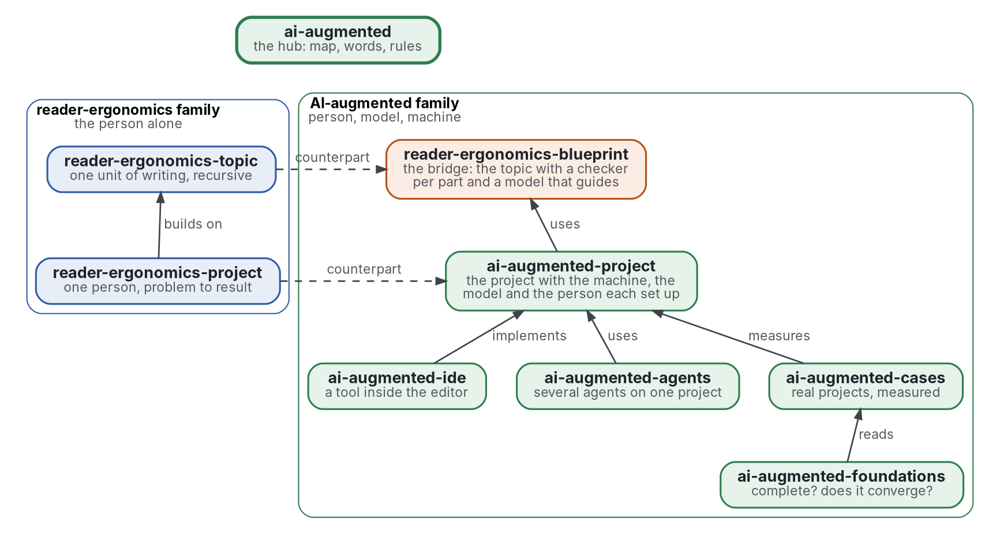

# AI-augmented

[](https://github.com/Tewf/ai-augmented/actions/workflows/checks.yml)
[](https://tewf.github.io/ai-augmented/)

La page d'accueil d'une famille de dépôts sur le **travail augmenté par l'IA**. Une personne, un modèle de langue et
une machine partagent un projet, chacun avec un rôle. Chaque affirmation est vérifiée là où elle se tient. Cette page
tient la carte, les mots que les membres partagent et la règle qu'ils suivent, un dépôt par problème et aucun
recouvrement entre deux, et rien qu'un membre possède.

Cette page en anglais : [README.md](README.md). Les deux versions suivent le même état.

> **État (2026-11-02) :** mis en place ; les membres tiennent leur périmètre et rien de plus. Le premier travail est une
> revue de littérature sur le nom que le domaine donne à cette famille, non commencée ; le préfixe est provisoire
> jusque-là. Ce n'est ni une norme officielle, ni une étude relue par des pairs, ni un résultat nouveau.
>
> **Comment il est fait :** avec Claude, un assistant IA d'Anthropic, sous la direction du mainteneur, comme
> reader-ergonomics. Les corrections sont bienvenues sous forme d'issues.

## La carte


<details>
<summary>Graphviz source</summary>



</details>

| Membre | Problème | État |
|---|---|---|
| [reader-ergonomics-blueprint](https://github.com/Tewf/reader-ergonomics-blueprint) | le raisonnement d'une personne en arbre de topics, un vérificateur par partie, Lean d'abord, un modèle qui interprète et oriente | revue faite, référence B1 nommée, rien de construit |
| [ai-augmented-project](https://github.com/Tewf/ai-augmented-project) | comment une personne, un modèle et une machine sont mis en place et mènent un projet ensemble | périmètre seul |
| [ai-augmented-ide](https://github.com/Tewf/ai-augmented-ide) | le logiciel qui met cette méthode en œuvre dans l'éditeur | périmètre seul |
| [ai-augmented-agents](https://github.com/Tewf/ai-augmented-agents) | plusieurs agents, personnes et modèles, sur un projet : délégation, coordination, incitations | périmètre seul |
| [ai-augmented-foundations](https://github.com/Tewf/ai-augmented-foundations) | si le topic récursif encode tout problème à un coût cognitif supportable, et à quelle vitesse un projet converge, vers quoi | périmètre seul |
| [ai-augmented-cases](https://github.com/Tewf/ai-augmented-cases) | ce que chaque projet réel mené avec la méthode a coûté et produit | périmètre seul |

Le pont est partagé avec la [famille reader-ergonomics](https://github.com/Tewf/reader-ergonomics/blob/b9732b9814c71768f722691f3c5049ec2b8ed378/extending.md) : le blueprint y reste membre, et
chaque membre ici obéit à [reader-ergonomics](https://github.com/Tewf/reader-ergonomics/blob/b9732b9814c71768f722691f3c5049ec2b8ed378/standard.md) (v1.19.2) et exécute ses vérifications en CI.

## Les règles

- **Un dépôt par problème.** Un membre répond à une question ; une seconde question est un second dépôt.
- **Aucun recouvrement.** Un fait vit dans un membre ; les autres le lient. Deux membres qui revendiquent la même chose
  dans leur table de périmètre sont un constat, et le premier travail ci-dessous le fait trouver par un programme.
- **Les dépendances pointent vers le bas.** Un membre utilise ce qui est sous lui et rien au-dessus ; cette page lie
  chaque membre et rien ne lie cette page.
- **Les noms sont provisoires jusqu'au cadrage.** La première étape de chaque revue trouve comment le domaine nomme la
  chose ; le dépôt est renommé alors, et GitHub redirige l'ancienne adresse.
- **Un modèle ne décide rien.** Sa sortie est vérifiée par un programme ou lue par la personne ; la position du
  blueprint vaut pour toute la famille.

## Les mots

| Mot | Sens ici |
|---|---|
| **personne** | qui possède le projet et décide de ce qui est affirmé |
| **modèle** | un modèle de langue : il explique, propose, traduit, rédige ; il ne décide rien |
| **machine** | les programmes qui vérifient : tests, hooks, CI, un assistant de preuve |
| **vérificateur** | un programme qui rend un verdict sur une partie, là où elle se tient |
| **oracle** | le vérificateur dont le verdict est tenu pour exact |
| **brief** | ce qu'un agent remet à un autre : la tâche, ce qui est décidé, ce qui est à trouver |
| **référence** | le résultat existant auquel un nouveau est comparé ; une revue finit quand elle peut en nommer un |

## Le premier travail : une revue de littérature

Non commencée. Elle est finie quand elle peut nommer la référence.

1. **Cadrer :** comment le domaine nomme une personne, un modèle et une machine qui mènent un projet. Pistes à vérifier,
   non des noms à affirmer : intelligence augmentation, hybrid intelligence, human-AI teaming, human-in-the-loop. Le
   préfixe de la famille en découle.
2. **Revue :** les synthèses d'abord, puis les travaux fondateurs, puis qui les cite.
3. **État de l'art, et le dossier contre.**
4. **Positionnement :** à quel domaine cette famille appartient, et ce qu'elle ajoute.
5. **Référence :** le vocabulaire et la carte qu'un domaine existant donne déjà, contre ceux ci-dessus.

À côté, la vérification propre à la famille : un programme qui lit la table de périmètre de chaque membre et échoue
quand deux membres revendiquent le même « dedans ». Savoir si une table de périmètre se lit assez sûrement pour une
vérification exacte est la question qu'il doit trancher.

## Vérifier

```sh
git clone https://github.com/Tewf/reader-ergonomics
python3 reader-ergonomics/checks/run.py chemin/vers/ce/depot
```

La CI exécute les mêmes vérifications à chaque push, et une exécution échoue à la première erreur
([checks.yml](https://github.com/Tewf/ai-augmented/blob/master/.github/workflows/checks.yml)). Chaque push sur master
construit aussi le site, [tewf.github.io/ai-augmented](https://tewf.github.io/ai-augmented/)
([pages.yml](https://github.com/Tewf/ai-augmented/blob/master/.github/workflows/pages.yml)).

## Contenu

| Partie | Résumé |
|---|---|
| [decisions](decisions/) | une fiche par choix qui façonne ce dépôt, chacune ouvrant sur la décision en une phrase |

## Licence

Code sous [Apache License 2.0](LICENSE) ; prose sous [CC BY 4.0](LICENSES/CC-BY-4.0.txt). Réutilisez-le comme vous le
souhaitez, en créditant ce dépôt ; [CITATION.cff](CITATION.cff) donne une citation si besoin.
