# AI-augmented

[](https://github.com/Tewf/ai-augmented/actions/workflows/checks.yml)
[](https://tewf.github.io/ai-augmented/)

La page d'accueil d'une famille de dépôts sur le **travail augmenté par l'IA**. Une personne, un modèle de langue et
une machine partagent un projet, chacun avec un rôle. Chaque affirmation est vérifiée là où elle se tient. Cette page
tient la carte, les mots que les membres partagent et la règle qu'ils suivent, un dépôt par problème et aucun
recouvrement entre deux, et rien qu'un membre possède.

Cette page en anglais : [README.md](README.md). Les deux versions suivent le même état.

> **État (2026-11-03) :** version 0.1.0. Fait : la carte, les mots, une première passe de revue de 27 sources qui nomme
> sa référence (le préfixe est conservé), trois principes, une forme, le style de lecteur d'un agent et quatre
> vérifications avec 52 tests unitaires. Ouvert : une passe complète de la revue avec citations suivantes et recherche
> grise, et le travail propre des membres. Ce n'est ni une norme officielle, ni une étude relue par des pairs, ni un résultat nouveau.
>
> **Comment il est fait :** avec Claude, un assistant IA d'Anthropic, sous la direction du mainteneur, comme
> reader-ergonomics. Les corrections sont bienvenues sous forme d'issues.

## La prendre

La carte et la forme de la famille sont faites pour être copiées et gardées. Copiez-les depuis une version étiquetée
([étiquettes](https://github.com/Tewf/ai-augmented/tags)), pour qu'un changement ultérieur ici ne change jamais votre
copie.

1. Copiez [standard.md](standard.md), la carte, les [principles/](principles/) que vous gardez et
   [shapes/scope-table.md](shapes/scope-table.md), la forme du périmètre d'un membre, aux mêmes chemins de votre dépôt.
   Copiez [checks/local/](checks/local/) et [checks/test_local_checks.py](checks/test_local_checks.py) pour les
   vérifications qui les tiennent.
2. Donnez à chaque membre une page d'accueil avec un tableau de périmètre aux lignes dedans, plus tard et dehors, chacune
   disant pourquoi.
3. Ajoutez `checks/config.toml` avec `extends = "reader-ergonomics"`, comme [celui-ci](checks/config.toml).
4. Épinglez la norme par son commit, comme [checks.yml](.github/workflows/checks.yml), et lancez ses vérifications :

   ```sh
   git clone https://github.com/Tewf/reader-ergonomics
   git -C reader-ergonomics checkout 65e42472e2d4cbfd994c2a86e95a47e5dc7301ca
   python3 reader-ergonomics/checks/run.py chemin/vers/votre/depot
   ```

5. Comment prendre votre propre version, et où va un désaccord : la section
   [Take your own version](https://github.com/Tewf/reader-ergonomics/blob/65e42472e2d4cbfd994c2a86e95a47e5dc7301ca/README.md#take-your-own-version)
   de la norme.

## La carte

```dot
// The map of the two families. Colours: reader-ergonomics family blue, AI-augmented family green, the bridge orange,
// each kind named in its box; this page, the hub, has the thick border and nothing points to it.
digraph map {
  graph [rankdir=TB, nodesep=0.35, ranksep=0.45, bgcolor="white", pad=0.2, fontname="Inter", compound=true, newrank=true];
  node  [shape=box, style="rounded,filled", fontname="Inter", fontsize=13, margin="0.2,0.1", penwidth=1.5, fontcolor="#1F2328"];
  edge  [fontname="Inter", fontsize=11, color="#3D434B", fontcolor="#55575F", penwidth=1.3, arrowsize=0.8];
  HUB [label=<<b>ai-augmented</b><br/><font point-size="11" color="#55575F">the hub: map, words, rules</font>>, fillcolor="#E6F2EA", color="#2E7D4F", penwidth=2.6];
  subgraph cluster_re {
    label=<<b>reader-ergonomics family</b><br/><font point-size="11" color="#55575F">the person alone</font>>; labeljust=l; style="rounded"; color="#2F5DA8"; fontname="Inter"; fontsize=12;
    T [label=<<b>reader-ergonomics-topic</b><br/><font point-size="11" color="#55575F">one unit of writing, recursive</font>>, fillcolor="#E8EEF8", color="#2F5DA8"];
    P [label=<<b>reader-ergonomics-project</b><br/><font point-size="11" color="#55575F">one person, problem to result</font>>, fillcolor="#E8EEF8", color="#2F5DA8"];
    RV [label=<<b>reader-ergonomics-review</b><br/><font point-size="11" color="#55575F">the review as a genre</font>>, fillcolor="#E8EEF8", color="#2F5DA8"];
  }
  subgraph cluster_ai {
    label=<<b>AI-augmented family</b><br/><font point-size="11" color="#55575F">person, model, machine</font>>; labeljust=l; style="rounded"; color="#2E7D4F"; fontname="Inter"; fontsize=12;
    BP [label=<<b>reader-ergonomics-blueprint</b><br/><font point-size="11" color="#55575F">the bridge: the topic with a checker</font><br/><font point-size="11" color="#55575F">per part and a model that guides</font>>, fillcolor="#FBEDE4", color="#B4541A"];
    AP [label=<<b>ai-augmented-project</b><br/><font point-size="11" color="#55575F">the project with the machine, the</font><br/><font point-size="11" color="#55575F">model and the person each set up</font>>, fillcolor="#E6F2EA", color="#2E7D4F"];
    IDE [label=<<b>ai-augmented-ide</b><br/><font point-size="11" color="#55575F">a tool inside the editor</font>>, fillcolor="#E6F2EA", color="#2E7D4F"];
    AG [label=<<b>ai-augmented-agents</b><br/><font point-size="11" color="#55575F">several agents on one project</font>>, fillcolor="#E6F2EA", color="#2E7D4F"];
    F [label=<<b>ai-augmented-foundations</b><br/><font point-size="11" color="#55575F">complete? does it converge?</font>>, fillcolor="#E6F2EA", color="#2E7D4F"];
    C [label=<<b>ai-augmented-cases</b><br/><font point-size="11" color="#55575F">real projects, measured</font>>, fillcolor="#E6F2EA", color="#2E7D4F"];
    PRC [label=<<b>ai-augmented-practice</b><br/><font point-size="11" color="#55575F">each practice as an algorithm</font>>, fillcolor="#E6F2EA", color="#2E7D4F"];
    DG [label=<<b>ai-augmented-data-gathering</b><br/><font point-size="11" color="#55575F">efficient data gathering</font>>, fillcolor="#E6F2EA", color="#2E7D4F"];
    LO [label=<<b>ai-augmented-law-oracle</b><br/><font point-size="11" color="#55575F">a statute encoded by a model,</font><br/><font point-size="11" color="#55575F">accepted at zero disagreement</font>>, fillcolor="#E6F2EA", color="#2E7D4F"];
    LA [label=<<b>ai-augmented-legal-agent</b><br/><font point-size="11" color="#55575F">one role: a skill with</font><br/><font point-size="11" color="#55575F">programs and a fixed point</font>>, fillcolor="#E6F2EA", color="#2E7D4F"];
  }
  HUB -> T [style=invis];
  HUB -> BP [style=invis];
  T -> BP [label=" counterpart", style=dashed, constraint=false];
  P -> AP [label=" counterpart", style=dashed, constraint=false];
  T -> P [dir=back, label=" builds on"];
  BP -> AP [dir=back, label=" uses"];
  AP -> IDE [dir=back, label=" implements"];
  AP -> AG [dir=back, label=" uses"];
  AP -> C [dir=back, label=" measures"];
  C -> F [dir=back, label=" reads"];
  AP -> PRC [dir=back, label=" reads"];
  PRC -> DG [label=" links"];
  AG -> LA [dir=back, label=" applies"];
  LO -> LA [dir=back, label=" quotes"];
  T -> RV [dir=back, label=" builds on"];
  DG -> RV [style=dashed, label=" reviews in its shapes", constraint=false];
  RV -> P [style=invis];
  {rank=same; T; BP}
  {rank=same; P; AP}
}
```

![Deux familles côte à côte : dans la famille reader-ergonomics, le topic et le projet ; dans la famille AI-augmented, le blueprint comme pont, le projet, l'IDE qui le met en œuvre, les agents et les cas qui l'utilisent et le mesurent, la carte des pratiques et la collecte de données qu'elle lie, les fondements qui lisent les cas, et l'agent juridique, qui applique les agents et cite l'oracle du droit. Le genre de la revue est dans la première famille. Le hub est au-dessus des deux et rien ne pointe vers lui.](map.svg)

<details>
<summary>Source Graphviz</summary>



</details>

| Membre | Problème | État |
|---|---|---|
| [reader-ergonomics-blueprint](https://github.com/Tewf/reader-ergonomics-blueprint) | le raisonnement d'une personne en arbre de topics, un vérificateur par partie, Lean d'abord, un modèle qui interprète et oriente | revue faite, référence B1 nommée, rien de construit |
| [ai-augmented-project](https://github.com/Tewf/ai-augmented-project) | comment une personne, un modèle et une machine sont mis en place et mènent un projet ensemble | revue faite (39 sources, référence B1), document de conception écrit, en attente d'approbation |
| [ai-augmented-ide](https://github.com/Tewf/ai-augmented-ide) | le logiciel qui met cette méthode en œuvre dans l'éditeur | état de l'art fait (28 sources), référence Kilo Code ; rien de construit encore |
| [ai-augmented-agents](https://github.com/Tewf/ai-augmented-agents) | plusieurs agents, personnes et modèles, sur un projet : délégation, coordination, incitations | revue faite (35 sources), référence l'arrangement du 2026-10-29 ; test du brief en cours |
| [ai-augmented-foundations](https://github.com/Tewf/ai-augmented-foundations) | si le topic récursif encode tout problème à un coût cognitif supportable, et à quelle vitesse un projet converge, vers quoi | revue faite (34 sources) ; un coût provisoire d'un arbre de topics, mesuré sur la famille |
| [ai-augmented-cases](https://github.com/Tewf/ai-augmented-cases) | ce que chaque projet réel mené avec la méthode a coûté et produit | revue faite (37 sources) ; deux cas écrits, avec leur programme de mesures |
| [ai-augmented-practice](https://github.com/Tewf/ai-augmented-practice) | chaque pratique de la méthode comme un algorithme pour un problème nommé, avec le meilleur algorithme connu, l'écart et le changement proposé | périmètre posé le 2026-11-03 ; première revue non commencée |
| [ai-augmented-data-gathering](https://github.com/Tewf/ai-augmented-data-gathering) | la manière la plus efficace de collecter des données en général, la quête d'information d'abord | périmètre posé le 2026-11-03 ; première revue non commencée |
| [ai-augmented-law-oracle](https://github.com/Tewf/ai-augmented-law-oracle) | un modèle traduit une loi en code et un verdict en mots ; law-oracle accepte la traduction ou non | une décision prise ; référence B2 lancée sur son jeu d'essai avec un modèle local 7B ; rien de construit en propre |
| [ai-augmented-legal-agent](https://github.com/Tewf/ai-augmented-legal-agent) | un rôle d'entreprise, le juridique, comme une compétence étendue par des programmes, un juge autre que lui et un point fixe | fiche et vérification du registre écrites, sept passes de revue ; pas encore au point fixe, en pause en attendant un exécuteur qui sépare les droits d'écriture |

La première famille a sa propre page d'accueil, [reader-ergonomics-family](https://github.com/Tewf/reader-ergonomics-family) ;
son pendant du projet est [reader-ergonomics-project](https://github.com/Tewf/reader-ergonomics-project), et son membre pour la revue de littérature comme genre est [reader-ergonomics-review](https://github.com/Tewf/reader-ergonomics-review).
Le pont est partagé avec la [famille reader-ergonomics](https://github.com/Tewf/reader-ergonomics/blob/65e42472e2d4cbfd994c2a86e95a47e5dc7301ca/extending.md) : le blueprint y reste membre, et
chaque membre ici obéit à [reader-ergonomics](https://github.com/Tewf/reader-ergonomics/blob/65e42472e2d4cbfd994c2a86e95a47e5dc7301ca/standard.md) (v1.24.2) et exécute ses vérifications en CI.

## Les règles

- **Un dépôt par problème.** Un membre répond à une question ; une seconde question est un second dépôt.
- **Aucun recouvrement.** Un fait vit dans un membre ; les autres le lient. Deux membres qui revendiquent la même chose
  dans leur table de périmètre sont un constat, et le premier travail ci-dessous le fait trouver par un programme.
- **Les dépendances pointent vers le bas.** Un membre utilise ce qui est sous lui et rien au-dessus ; cette page lie
  chaque membre et rien ne lie cette page.
- **Les noms suivent le cadrage.** La première étape de chaque revue trouve comment le domaine nomme la chose ; celle-ci l'a
  trouvé et garde le préfixe.

## Les mots

| Mot | Sens ici |
|---|---|
| **personne** | qui possède le projet et décide de ce qui est affirmé |
| **modèle** | un modèle de langue : il explique, propose, traduit, rédige ; il ne décide rien |
| **machine** | les programmes qui vérifient : tests, hooks, CI, un assistant de preuve |
| **vérificateur** | un programme qui rend un verdict sur une partie, là où elle se tient |
| **oracle** | le vérificateur dont le verdict est tenu pour exact |
| **brief** | ce qu'un agent remet à un autre : la tâche, ce qui est décidé, ce qui est à trouver |
| **référence** | le résultat existant auquel un nouveau est comparé ; une revue finit quand elle peut en nommer un |

## Ce que la revue a trouvé

Une première passe de 27 sources, dans [evidence](evidence/family-name/README.md).

1. **Le domaine dit intelligence augmentation et hybrid intelligence.** Engelbart 1962 et Licklider 1960 en sont les racines ; Akata 2020 est la communauté actuelle.
2. **L'équipe humain-IA ne convient qu'en partie.** Dans une équipe, le modèle est un coéquipier ; ici il ne décide rien. Le préfixe « AI-augmented » suit le domaine et est conservé, non renommé.
3. **Une combinaison n'est pas toujours meilleure.** Sur 106 expériences, les personnes avec un modèle ont fait moins bien que le meilleur des deux seul, g de -0,23 (secondaire), sur les décisions. Elles ont fait mieux sur la création de contenu (Vaccaro 2024). Chaque cas doit comparer l'humain seul, le modèle seul et les deux.
4. **La machine qui vérifie n'est pas un troisième rôle dans la littérature lue.** Les sources ont une personne et une IA ; la famille ajoute le programme qui vérifie, avec un verdict exact.

## La référence

**H1 :** le vocabulaire et la carte de la hybrid intelligence d'Akata 2020, avec les fonctions et niveaux de Parasuraman 2000 pour savoir qui fait quoi, et le plan de mesure de Vaccaro 2024.
Les fichiers d'agents et les motifs d'agents sont la pratique à comparer, comme exemples seulement.

## Le premier travail : fait en première passe

La revue est écrite en cinq étapes et nomme sa référence. Une passe complète, avec citations en aval et recherche de littérature grise, n'est pas faite.

À côté, la vérification propre à la famille, [scope_overlap.py](checks/local/scope_overlap.py) :

- elle lit la table de périmètre de chaque membre ;
- elle avertit quand deux membres partagent une expression de trois mots dans leurs lignes « dedans » ;
- elle n'échoue jamais, et ses tests disent ce qu'elle ne peut pas trancher ;
- les deux nouvelles vérifications, [three_arms.py](checks/local/three_arms.py) et [scope_table.py](checks/local/scope_table.py), tiennent le principe mesuré et la forme, et sont testées à côté ;
- sur les six membres d'aujourd'hui elle ne trouve aucune expression commune : les tables se lisent, mais le sens peut se recouvrir ;
- une passe sémantique, [scope_overlap_semantic.py](checks/local/scope_overlap_semantic.py), encode chaque ligne « dedans » ;
- elle avertit quand deux lignes de membres différents atteignent un cosinus de 0,70, seuil provisoire placé entre les recouvrements plantés et les non-recouvrements de ses tests ;
- sur les six membres elle avertit pour une paire, à 0,76 : les lignes de project et de ide sur ce qui est remis au modèle.

## Vérifier

```sh
git clone https://github.com/Tewf/reader-ergonomics
python3 reader-ergonomics/checks/run.py chemin/vers/ce/depot
```

La CI exécute les mêmes vérifications à chaque push, et une exécution échoue à la première erreur
([checks.yml](https://github.com/Tewf/ai-augmented/blob/master/.github/workflows/checks.yml)). Chaque push sur master
construit aussi le site, [tewf.github.io/ai-augmented](https://tewf.github.io/ai-augmented/)
([pages.yml](https://github.com/Tewf/ai-augmented/blob/master/.github/workflows/pages.yml)).

## Contenu

| Partie | Résumé |
|---|---|
| [standard.md](standard.md) | la fiche : les trois principes de cette famille et leurs niveaux de preuve |
| [principles](principles/) | un fichier par principe : comparer à chaque partie seule, un propriétaire par affirmation, une table de périmètre dit pourquoi |
| [reader-styles](reader-styles/agent.md) | le style de lecteur d'un agent à qui l'on remet un brief : cinq dérogations, chacune avec son niveau de preuve |
| [shapes](shapes/) | la table de périmètre que porte la page d'accueil de chaque membre, avec un exemple rempli |
| [evidence](evidence/) | la revue derrière cette page, et sa bibliographie |
| [decisions](decisions/) | une fiche par choix qui façonne ce dépôt, chacune ouvrant sur la décision en une phrase |

## Licence

Code sous [Apache License 2.0](LICENSE) ; prose sous [CC BY 4.0](LICENSES/CC-BY-4.0.txt). Réutilisez-le comme vous le
souhaitez, en créditant ce dépôt ; [CITATION.cff](CITATION.cff) donne une citation si besoin.
