# AI-augmented

[](https://github.com/Tewf/ai-augmented/actions/workflows/checks.yml)
[](https://tewf.github.io/ai-augmented/)

The front page of a family of repositories on **AI-augmented work**: a person, a language model and a machine that
share one project, each with a role, every claim checked where it stands. This page holds the map, the words the
members share, and the rule they obey: one repository per problem, and no overlap between two. It holds nothing a
member owns.

This page in French: [README.fr.md](README.fr.md).

> **Status (2026-11-03):** version 0.1.0. Built: the map, the words, a first-pass review of 27 sources that names its
> baseline (the prefix is kept), three principles, a shape, the reader style of an agent, and four checks with 52 unit
> tests. Open: a full review pass with forward citations and a grey search, and the members' own work. It is not an
> official standard, not a peer-reviewed study and not a new result.
>
> **How it is made:** with Claude, an AI assistant by Anthropic, under the maintainer's direction, the way
> reader-ergonomics was made. Corrections are welcome as issues.

## Take it

The family's card and shape are meant to be copied and kept as your own. Copy them from a tagged release
([tags](https://github.com/Tewf/ai-augmented/tags)), so a later change here never changes your copy.

1. Copy [standard.md](standard.md), the card, the [principles/](principles/) you keep, and [shapes/scope-table.md](shapes/scope-table.md),
   the shape of a member's scope, into the same paths of your repository. Copy [checks/local/](checks/local/) and
   [checks/test_local_checks.py](checks/test_local_checks.py) for the checks that hold them.
2. Give each member a front page with a scope table of in, later and out rows, each row saying why.
3. Add `checks/config.toml` with `extends = "reader-ergonomics"`, as [this one](checks/config.toml) does.
4. Pin the standard by commit, as [checks.yml](.github/workflows/checks.yml) does, and run its checks:

   ```sh
   git clone https://github.com/Tewf/reader-ergonomics
   git -C reader-ergonomics checkout 2e5b6f0c3e67d2dc8195a63cf882d46170e79a5a
   python3 reader-ergonomics/checks/run.py path/to/your/repository
   ```

5. How to take your own version, and where a disagreement goes: the standard's
   [Take your own version](https://github.com/Tewf/reader-ergonomics/blob/2e5b6f0c3e67d2dc8195a63cf882d46170e79a5a/README.md#take-your-own-version).

## The map

```dot
// The map of the two families. Colours: reader-ergonomics family blue, AI-augmented family green, the bridge orange,
// each kind named in its box; this page, the hub, has the thick border and nothing points to it.
digraph map {
  graph [rankdir=TB, nodesep=0.35, ranksep=0.45, bgcolor="white", pad=0.2, fontname="Inter", compound=true, newrank=true];
  node  [shape=box, style="rounded,filled", fontname="Inter", fontsize=13, margin="0.2,0.1", penwidth=1.5, fontcolor="#1F2328"];
  edge  [fontname="Inter", fontsize=11, color="#3D434B", fontcolor="#55575F", penwidth=1.3, arrowsize=0.8];
  HUB [label=<<b>ai-augmented</b><br/><font point-size="11" color="#55575F">the hub: map, words, rules</font>>, fillcolor="#E6F2EA", color="#2E7D4F", penwidth=2.6];
  subgraph cluster_re {
    label=<<b>reader-ergonomics family</b><br/><font point-size="11" color="#55575F">the person alone</font>>; labeljust=l; style="rounded"; color="#2F5DA8"; fontname="Inter"; fontsize=12;
    T [label=<<b>reader-ergonomics-topic</b><br/><font point-size="11" color="#55575F">one unit of writing, recursive</font>>, fillcolor="#E8EEF8", color="#2F5DA8"];
    P [label=<<b>reader-ergonomics-project</b><br/><font point-size="11" color="#55575F">one person, problem to result</font>>, fillcolor="#E8EEF8", color="#2F5DA8"];
    RV [label=<<b>reader-ergonomics-review</b><br/><font point-size="11" color="#55575F">the review as a genre</font>>, fillcolor="#E8EEF8", color="#2F5DA8"];
  }
  subgraph cluster_ai {
    label=<<b>AI-augmented family</b><br/><font point-size="11" color="#55575F">person, model, machine</font>>; labeljust=l; style="rounded"; color="#2E7D4F"; fontname="Inter"; fontsize=12;
    BP [label=<<b>reader-ergonomics-blueprint</b><br/><font point-size="11" color="#55575F">the bridge: the topic with a checker</font><br/><font point-size="11" color="#55575F">per part and a model that guides</font>>, fillcolor="#FBEDE4", color="#B4541A"];
    AP [label=<<b>ai-augmented-project</b><br/><font point-size="11" color="#55575F">the project with the machine, the</font><br/><font point-size="11" color="#55575F">model and the person each set up</font>>, fillcolor="#E6F2EA", color="#2E7D4F"];
    IDE [label=<<b>ai-augmented-ide</b><br/><font point-size="11" color="#55575F">a tool inside the editor</font>>, fillcolor="#E6F2EA", color="#2E7D4F"];
    AG [label=<<b>ai-augmented-agents</b><br/><font point-size="11" color="#55575F">several agents on one project</font>>, fillcolor="#E6F2EA", color="#2E7D4F"];
    F [label=<<b>ai-augmented-foundations</b><br/><font point-size="11" color="#55575F">complete? does it converge?</font>>, fillcolor="#E6F2EA", color="#2E7D4F"];
    C [label=<<b>ai-augmented-cases</b><br/><font point-size="11" color="#55575F">real projects, measured</font>>, fillcolor="#E6F2EA", color="#2E7D4F"];
    PRC [label=<<b>ai-augmented-practice</b><br/><font point-size="11" color="#55575F">each practice as an algorithm</font>>, fillcolor="#E6F2EA", color="#2E7D4F"];
    DG [label=<<b>ai-augmented-data-gathering</b><br/><font point-size="11" color="#55575F">efficient data gathering</font>>, fillcolor="#E6F2EA", color="#2E7D4F"];
  }
  HUB -> T [style=invis];
  HUB -> BP [style=invis];
  T -> BP [label=" counterpart", style=dashed, constraint=false];
  P -> AP [label=" counterpart", style=dashed, constraint=false];
  T -> P [dir=back, label=" builds on"];
  BP -> AP [dir=back, label=" uses"];
  AP -> IDE [dir=back, label=" implements"];
  AP -> AG [dir=back, label=" uses"];
  AP -> C [dir=back, label=" measures"];
  C -> F [dir=back, label=" reads"];
  AP -> PRC [dir=back, label=" reads"];
  PRC -> DG [label=" links"];
  T -> RV [dir=back, label=" builds on"];
  DG -> RV [style=dashed, label=" reviews in its shapes", constraint=false];
  {rank=same; T; BP}
  {rank=same; P; AP}
}
```


<details>
<summary>Graphviz source</summary>



</details>

| Member | Problem | Status |
|---|---|---|
| [reader-ergonomics-blueprint](https://github.com/Tewf/reader-ergonomics-blueprint) | a person's reasoning as a tree of topics, a checker per part, Lean first, a model that interprets and guides | review done, baseline B1 named, nothing built |
| [ai-augmented-project](https://github.com/Tewf/ai-augmented-project) | how a person, a model and a machine are set up and run one project together | review done (39 sources, baseline B1), design document written, awaiting approval |
| [ai-augmented-ide](https://github.com/Tewf/ai-augmented-ide) | the software that implements that method inside the editor | état de l'art done (28 sources), baseline Kilo Code; nothing built yet |
| [ai-augmented-agents](https://github.com/Tewf/ai-augmented-agents) | several agents, people and models, on one project: delegation, coordination, incentives | review done (35 sources), baseline the 2026-10-29 arrangement; brief test running |
| [ai-augmented-foundations](https://github.com/Tewf/ai-augmented-foundations) | whether the recursive topic encodes every problem at a cognitive cost a person bears, and how fast a project converges, to what | review done (34 sources); a provisional cost of a tree of topics, measured on the family |
| [ai-augmented-cases](https://github.com/Tewf/ai-augmented-cases) | what each real project run with the method cost and produced | review done (37 sources); two cases written, with their measures program |
| [ai-augmented-practice](https://github.com/Tewf/ai-augmented-practice) | each practice of the method as an algorithm for a named problem, with the best-known algorithm, the gap and the change proposed | scope set out 2026-11-03; first review not started |
| [ai-augmented-data-gathering](https://github.com/Tewf/ai-augmented-data-gathering) | the most efficient way to gather data in general, information foraging first | scope set out 2026-11-03; first review not started |

The first family has its own front page, [reader-ergonomics-family](https://github.com/Tewf/reader-ergonomics-family); its
counterpart of the project is [reader-ergonomics-project](https://github.com/Tewf/reader-ergonomics-project), and its member for the literature review as a genre is [reader-ergonomics-review](https://github.com/Tewf/reader-ergonomics-review).
The bridge is shared with the [reader-ergonomics family](https://github.com/Tewf/reader-ergonomics/blob/2e5b6f0c3e67d2dc8195a63cf882d46170e79a5a/extending.md): the blueprint stays a member there, and
every member here obeys [reader-ergonomics](https://github.com/Tewf/reader-ergonomics/blob/2e5b6f0c3e67d2dc8195a63cf882d46170e79a5a/standard.md) (v1.21.0) and runs its checks in CI.

## The rules

- **One repository per problem.** A member answers one question; a second question is a second repository.
- **No overlap.** A fact lives in one member; the others link it. Two members that claim the same thing in their
  scope tables are a finding, and a program warns on it.
- **Dependencies point down.** A member uses what sits below it and nothing above; this page links every member and
  nothing links this page.
- **Names follow the frame step.** Each review's first step finds what the field calls the thing; this one found it
  and keeps the prefix.
- **A model decides nothing.** Its output is checked by a program or read by the person; the blueprint's position
  holds for the whole family.

## The words

| Word | Meaning here |
|---|---|
| **person** | who owns the project and decides what is claimed |
| **model** | a language model: it explains, proposes, translates, drafts; it decides nothing |
| **machine** | the programs that check: tests, hooks, CI, a proof assistant |
| **checker** | a program that returns a verdict on one part, where it stands |
| **oracle** | the checker whose verdict is taken as exact |
| **brief** | what one agent hands another: the task, what is decided, what is to be found |
| **baseline** | the existing result a new one is compared against; a review ends when it can name one |

## What the review found

A first pass of 27 sources, in [evidence](evidence/family-name/README.md).

1. **The field's names are intelligence augmentation and hybrid intelligence.** Engelbart 1962 and Licklider 1960 are the roots; Akata 2020 is the living community.
2. **Teaming fits only in part.** In teaming the model is a teammate; here the model decides nothing. The prefix "AI-augmented" matches the field and is kept, not renamed.
3. **A combination is not always better.** Across 106 experiments, people with a model did worse than the best of either alone, g of -0.23 (secondary), on decisions, and better on content creation (Vaccaro 2024). Each case must compare human alone, model alone and both.
4. **The checking machine is not a third role in the literature read.** The sources have a person and an AI; the family adds the program that checks, with an exact verdict.

## The baseline

**H1:** the vocabulary and map of Akata 2020's hybrid intelligence, with Parasuraman 2000's functions and levels for who does what, and Vaccaro 2024's design for measuring.
Agent files and agent patterns are the practice to compare with, as examples only.

## The first job: done as a first pass

The review is written in five steps and names its baseline. A full pass, with forward citations and a grey search, is not done.

Beside it, the family's own check, [scope_overlap.py](checks/local/scope_overlap.py): a program that reads every member's scope table
and warns when two members share a phrase of three words in their "in" rows. It warns and never fails, and its tests
say what it cannot decide. The two new checks, [three_arms.py](checks/local/three_arms.py) and [scope_table.py](checks/local/scope_table.py), hold
the measured principle and the shape, and are tested beside it. On the six members today it finds no shared phrase, which shows that the tables can be read, not that they do not overlap in meaning.

A semantic pass, [scope_overlap_semantic.py](checks/local/scope_overlap_semantic.py), embeds each "in" row.
It warns when two rows of different members reach a cosine of 0.70, provisional and set between the planted overlaps and the known non-overlaps of its tests.
On the six members it warns on one pair, at 0.76: the project and the ide rows on what the model is handed.

## Check it

```sh
git clone https://github.com/Tewf/reader-ergonomics
python3 reader-ergonomics/checks/run.py path/to/this/repository
```

CI runs the same checks on every push, and a run fails on any error
([checks.yml](https://github.com/Tewf/ai-augmented/blob/master/.github/workflows/checks.yml)). Every push to master
also renders the site, [tewf.github.io/ai-augmented](https://tewf.github.io/ai-augmented/)
([pages.yml](https://github.com/Tewf/ai-augmented/blob/master/.github/workflows/pages.yml)).

## Contents

| Part | Summary |
|---|---|
| [standard.md](standard.md) | the card: the three principles of this family and their grades |
| [principles](principles/) | one file per principle: compare with each part alone, one owner per claim, a scope table says why |
| [reader-styles](reader-styles/agent.md) | the reader style of an agent that is handed a brief: five overrides, each with its grade |
| [shapes](shapes/) | the scope table every member's front page carries, with one filled example |
| [evidence](evidence/) | the review behind this page, and its bibliography |
| [decisions](decisions/) | one record per choice that shapes this repository, each opening with the decision in one sentence |

## Licence

Code under the [Apache License 2.0](LICENSE); prose under [CC BY 4.0](LICENSES/CC-BY-4.0.txt). Reuse it as you wish,
with credit to this repository; [CITATION.cff](CITATION.cff) gives a citation if you need one.
